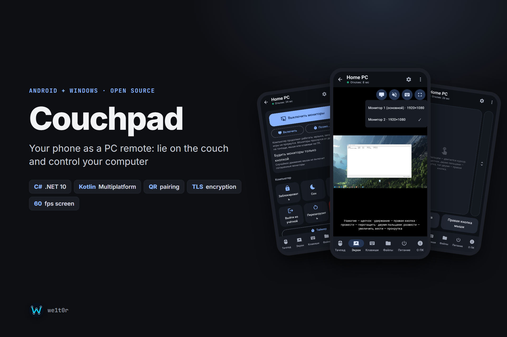
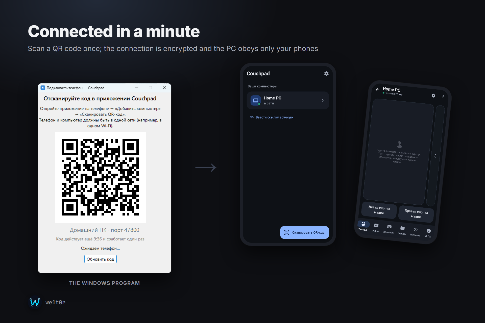
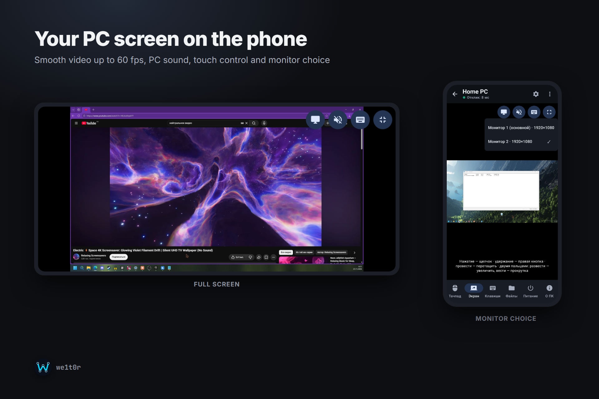
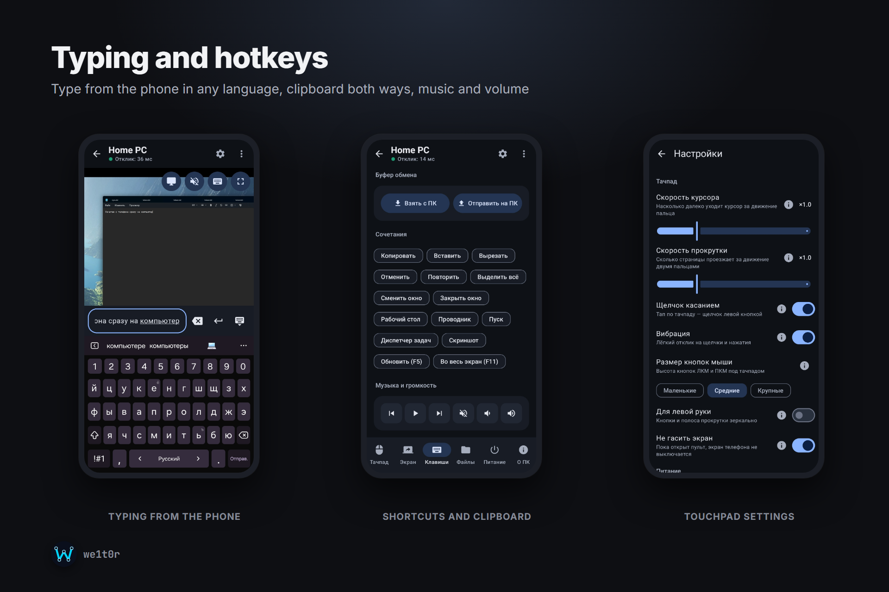
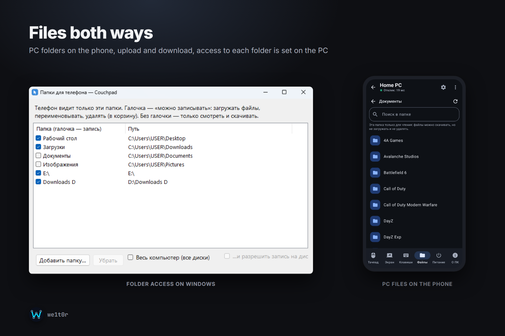
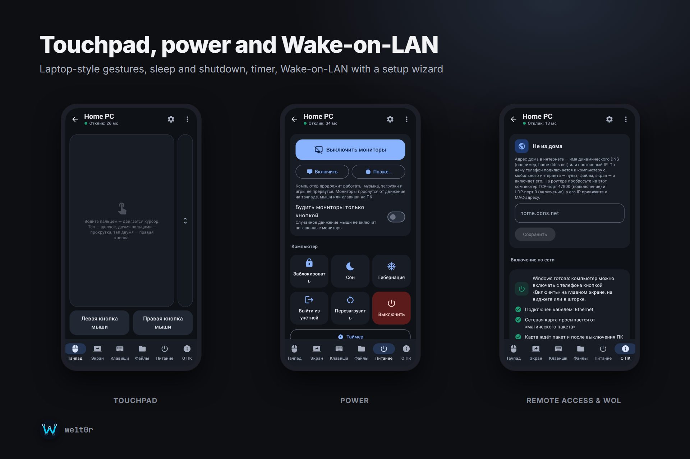

# Couchpad

[Русский](README.md) · **English**



Turn your Android phone into a remote for your Windows PC. Lie down on the couch and control the computer: touchpad, keyboard, volume, shutdown, files, the screen with sound. Over home Wi-Fi and, if you set it up, over the internet.

Open source, no ads, no accounts, no tracking. Built with AI — [details](#how-it-was-made).

## Features

- **Touchpad and mouse buttons** — laptop-style gestures: two-finger scroll, right click, drag.
- **Keyboard** — type from the phone or by voice, in any language and with emoji; Esc, Win, Alt+Tab, F1–F12 and more.
- **PC screen on the phone** — smooth video (up to 60 fps), PC sound, control by touch.
- **Files both ways** — browse PC folders from the phone and phone folders from the PC, "Share" → to PC, "Send to phone" in Explorer.
- **Clipboard** — text and images in both directions.
- **Power** — shut down, restart, sleep, turn off monitors, timer.
- **Wake-on-LAN** — turn on a powered-off PC from the phone, with a setup wizard.
- **Windows sign-in from the phone** — sign-in and lock screen, the "Allow changes" (UAC) prompt — optional.
- **Over the internet** — with a public IP or DDNS and port forwarding on the router, or through your own VPN (e.g. Tailscale).

Pairing is a one-time QR code scan. The connection is encrypted, and the PC only accepts commands from paired phones.

**Languages:** the phone app is in English and Russian (it follows the phone's language). The Windows program is in Russian for now; English is coming in the next version.

## Screenshots

The screenshots show the app in Russian; with an English phone language it is in English.







## Installation

Downloads are on the [Releases](../../releases) page.

1. **PC (Windows 10/11, 64-bit):** download `Couchpad-Setup-<version>.exe` and run it. Windows may show "Windows protected your PC" because the installer is not signed with a certificate yet: click "More info" → "Run anyway". Then click "Install" and allow administrator access. A window with a QR code opens.
2. **Phone (Android 8 or newer):** download `Couchpad-<version>.apk` and open it. Android will ask to allow installs from this source — allow it.
3. In the app, tap "Scan QR code" and point the camera at the PC screen. The phone and the PC must be on the same Wi-Fi network.

To update, install the new installer and the new APK over the old ones: paired phones and settings are kept. To uninstall: Windows Settings → Apps → Couchpad.

## Roadmap

What's planned next. The order isn't final: if you have an idea or a wish, open an [issue](../../issues/new/choose).

- [ ] **Game buttons on the Screen tab** — a WASD joystick, Space, left and right mouse buttons over the picture, to play from the couch.
- [ ] **Games running as administrator** — right now Windows blocks key presses from the phone in them.
- [ ] **Update check** — the Windows program finds a new version and installs it with one click; the app tells you when a new version is out.
- [ ] **Remember the chosen monitor** — separately for each PC.
- [ ] **English Windows program** and translation of the remaining spots in the app.
- [ ] **"Report a problem"** right from the app and the tray icon.
- [ ] **App version in settings.**
- [ ] **Keep the sound** when the PC switches from speakers to headphones.
- [ ] **F-Droid** — install and update the app from the catalog.

## How it was made

Couchpad was built together with [Claude](https://claude.ai), an AI assistant by Anthropic, in Claude Code. Claude wrote the code of the Windows program and the app, the tests and the docs; the author came up with what it should do and how, made the decisions, tested everything on a real PC and phone and rejected what didn't work right. Commits made with Claude are marked with a `Co-Authored-By: Claude` line.

## Support the project

Couchpad is free and will stay free. If you find it useful, you can support development on [Boosty](https://boosty.to/we1t0r).

## For developers

- `agent/` — the Windows program (C# / .NET 10, WinForms tray app, ASP.NET Core Kestrel).
- `mobile/` — the app (Kotlin Multiplatform + Compose Multiplatform): Android now, iPhone later.
- `protocol/PROTOCOL.md` — how the app and the PC program talk to each other (in Russian).

Agent (requires .NET 10 SDK):

```bash
dotnet build agent/Couchpad.Agent.slnx
dotnet test agent/Couchpad.Agent.slnx
```

Android app (requires JDK 17+ and Android SDK 36; SDK path in `ANDROID_HOME` or `mobile/local.properties`):

```bash
cd mobile && ./gradlew :androidApp:assembleDebug
```

Compatibility test of the app against the real agent (Windows, the agent must be built): `./gradlew :shared:jvmTest`. The agent runs in `--loopback --input-log` mode — it listens on 127.0.0.1 only and doesn't touch the real mouse, screen or sound.

Release builds — the Windows installer (a single file with .NET built in) and the signed APK in `dist/`:

```bash
powershell -ExecutionPolicy Bypass -File tools/release.ps1
```

The APK signing key is kept outside the project: `%USERPROFILE%\.couchpad\` (`release.jks` and `signing.properties`).

## License

[GPL-3.0](LICENSE): you are free to use, modify and share it, but modified versions must stay open source too.
