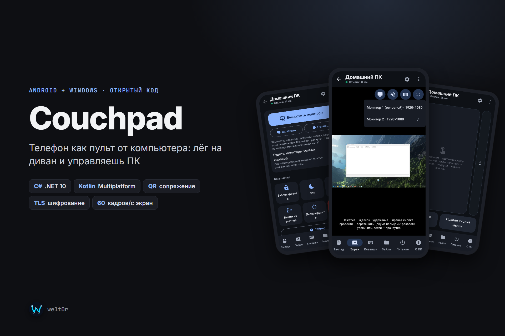
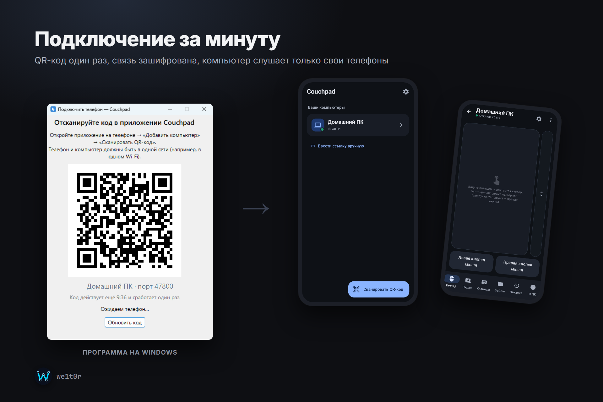
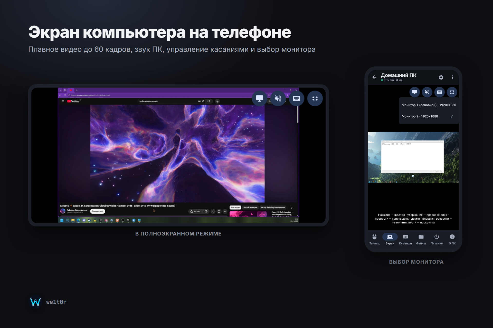
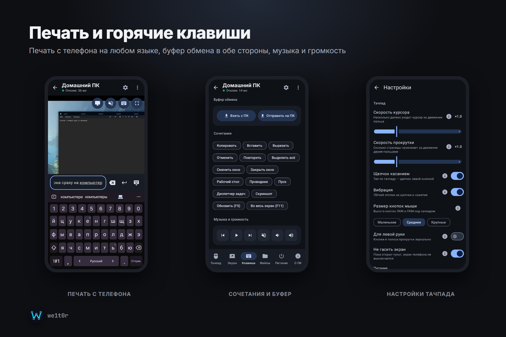
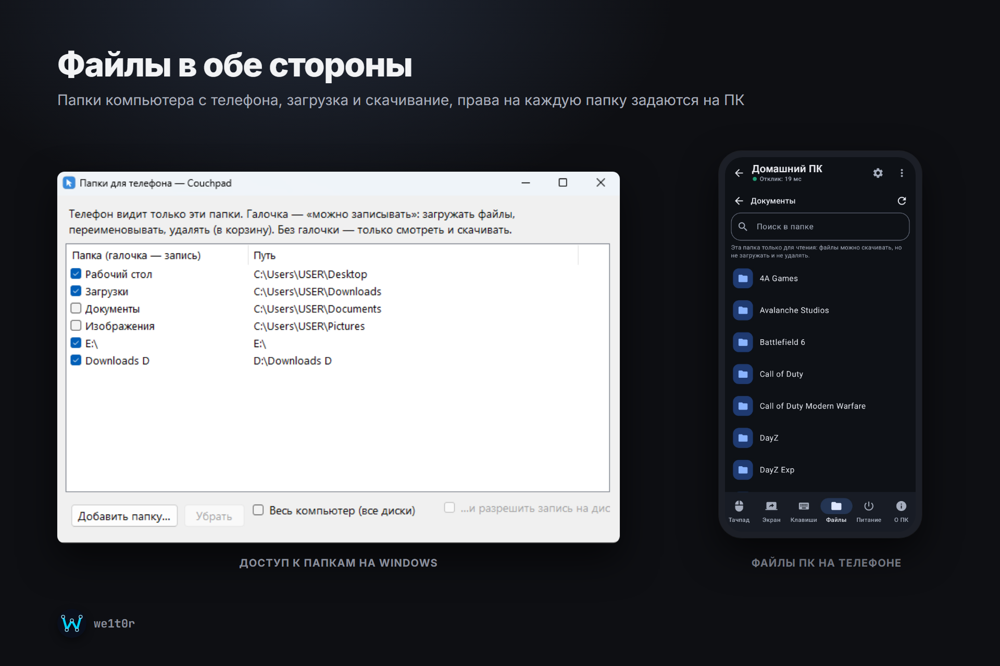
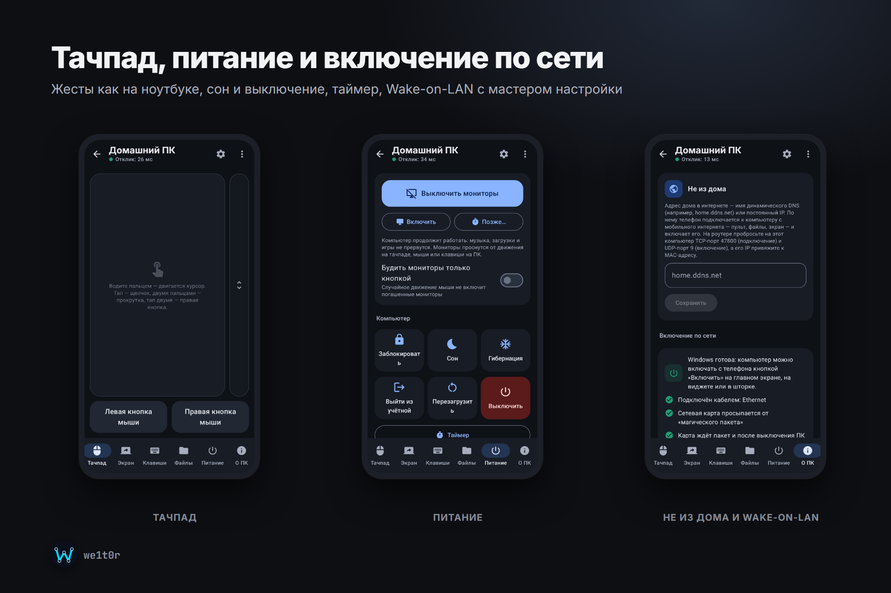

# Couchpad

**Русский** · [English](README.en.md)



Телефон на Android как пульт от компьютера с Windows. Лёг на диван — и управляешь ПК: тачпад, клавиатура, громкость, выключение, файлы, экран со звуком. Дома по Wi-Fi и, если настроить, через интернет.

Открытый код, без рекламы, без аккаунтов и слежки. Написан с помощью ИИ — [подробнее](#как-сделан).

## Что умеет

- **Тачпад и кнопки мыши** — жесты как на ноутбуке: прокрутка двумя пальцами, правая кнопка, перетаскивание.
- **Клавиатура** — печать с телефона и голосом, на любом языке и с эмодзи; Esc, Win, Alt+Tab, F1–F12 и другие клавиши.
- **Экран компьютера на телефоне** — плавное видео (до 60 кадров в секунду), звук компьютера, управление касаниями.
- **Файлы в обе стороны** — открыть папки компьютера с телефона и папки телефона с компьютера, «Поделиться» → на ПК, «Отправить на телефон» в Проводнике.
- **Буфер обмена** — текст и картинки туда и обратно.
- **Питание** — выключить, перезагрузить, сон, погасить мониторы, таймер.
- **Включение по сети** (Wake-on-LAN) — включить выключенный ПК с телефона, с мастером настройки.
- **Вход в Windows с телефона** — экран входа и блокировки, окно «Разрешить изменения» (UAC) — по желанию.
- **Через интернет** — по белому IP или DDNS с пробросом порта на роутере, или через свой VPN (например, Tailscale).

Подключение — по QR-коду, один раз. Связь зашифрована, компьютер принимает команды только от сопряжённых телефонов.

**Языки:** приложение на телефоне — на русском и английском (по языку телефона). Программа для Windows пока только на русском, английский — в следующей версии.

## Как выглядит







## Установка

Файлы — на странице [Releases](../../releases).

1. **Компьютер (Windows 10/11, 64 бит):** скачайте `Couchpad-Setup-<версия>.exe` и запустите. Windows может показать «Windows защитила ваш компьютер» — установщик пока не подписан сертификатом: нажмите «Подробнее» → «Выполнить в любом случае». Дальше — кнопка «Установить» и разрешение администратора. Откроется окно с QR-кодом.
2. **Телефон (Android 8 и новее):** скачайте `Couchpad-<версия>.apk` и откройте. Android попросит разрешить установку из этого источника — разрешите.
3. В приложении нажмите «Сканировать QR-код» и наведите камеру на экран компьютера. Телефон и компьютер должны быть в одной сети Wi-Fi.

Обновление — так же: новый установщик и новый APK ставятся поверх, телефоны и настройки сохраняются. Удаление — «Параметры Windows» → «Приложения» → Couchpad.

## Планы

Что хочется сделать дальше. Порядок не окончательный: есть идея или пожелание — пишите в [Issues](../../issues/new/choose).

- [ ] **Игровые кнопки на вкладке «Экран»** — джойстик для WASD, пробел, левая и правая кнопки мыши поверх картинки, чтобы играть с дивана.
- [ ] **Игры, запущенные от имени администратора** — сейчас Windows не пускает в них нажатия с телефона.
- [ ] **Проверка обновлений** — программа для Windows сама находит новую версию и ставит её по кнопке, приложение показывает, что вышла новая версия.
- [ ] **Запоминать выбранный монитор** — для каждого компьютера свой.
- [ ] **Программа для Windows на английском** и перевод оставшихся мест в приложении.
- [ ] **«Сообщить о проблеме»** прямо из приложения и из значка в трее.
- [ ] **Версия приложения в настройках.**
- [ ] **Звук не пропадает**, если на компьютере переключили колонки на наушники.
- [ ] **F-Droid** — чтобы ставить и обновлять приложение из каталога.

## Как сделан

Couchpad разработан вместе с [Claude](https://claude.ai) — ИИ-ассистентом от Anthropic, в Claude Code. Код программы для Windows и приложения, тесты и описания написал Claude; автор придумал, что и как должно работать, принимал решения, проверял всё на своём компьютере и телефоне и отбраковывал то, что работало не так. Коммиты, сделанные вместе с Claude, отмечены строкой `Co-Authored-By: Claude`.

## Поддержать проект

Couchpad бесплатный и останется таким. Если он вам пригодился, можно поддержать разработку на [Boosty](https://boosty.to/we1t0r).

## Для разработчиков

- `agent/` — программа для Windows (C# / .NET 10, WinForms в трее, ASP.NET Core Kestrel).
- `mobile/` — приложение (Kotlin Multiplatform + Compose Multiplatform): сейчас Android, позже iPhone.
- `protocol/PROTOCOL.md` — как приложение и программа на ПК общаются.

Агент (нужен .NET 10 SDK):

```bash
dotnet build agent/Couchpad.Agent.slnx
dotnet test agent/Couchpad.Agent.slnx
```

Приложение для Android (нужны JDK 17+ и Android SDK 36; путь к SDK — в `ANDROID_HOME` или `mobile/local.properties`):

```bash
cd mobile && ./gradlew :androidApp:assembleDebug
```

Тест совместимости приложения с настоящим агентом (Windows, агент должен быть собран): `./gradlew :shared:jvmTest`. Агент запускается в режиме `--loopback --input-log` — слушает только 127.0.0.1 и не трогает настоящие мышь, экран и звук.

Раздача — установщик для Windows (один файл со встроенным .NET) и подписанный APK в папке `dist/`:

```bash
powershell -ExecutionPolicy Bypass -File tools/release.ps1
```

Ключ подписи APK лежит вне проекта: `%USERPROFILE%\.couchpad\` (`release.jks` и `signing.properties`).

## Лицензия

[GPL-3.0](LICENSE): пользоваться, менять и распространять можно свободно, но изменённые версии тоже должны оставаться открытыми.
